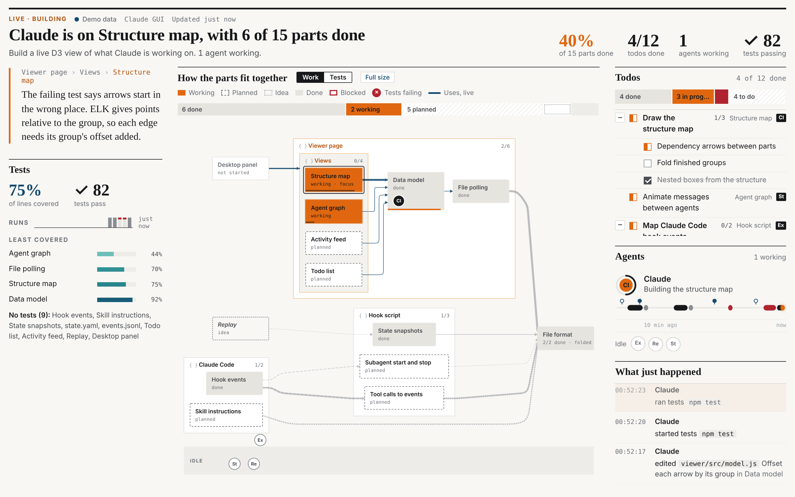

# Claude GUI



A live D3 view of what Claude is working on. It shows a headline of where Claude is, a map of the app's parts as nested boxes with arrows for what uses what (laid out by ELK), the current thought, agents and the messages between them, a todo list with sub-todos, and an activity feed.

On a wide screen everything fits on one page: the headline and four numbers on top, then three columns (the current thought, tests and agents; the map, scaled to fit, with a Full size button; todos and the activity feed). Narrow screens stack the same panels.

Tests: the hook spots test commands (npm test, pytest, jest, vitest, cargo test, go test, node --test and others), reads the pass/fail summary and failing test names, and logs a `test` event. Claude adds the diagnosis in `state.yaml` under `tests:` (which part the cause is in, and why). The Tests panel shows recent runs as a strip, each suite, and each failure with its cause; failing parts get a red badge on the map, and hovering a failure lights up its part.

Coverage: after a test run the hook also looks for a fresh coverage report (coverage/coverage-summary.json, coverage-final.json, lcov.info, coverage.py's coverage.json, Cobertura coverage.xml, or Go's cover.out) and saves per-file line counts to `.claude-gui/coverage.json`. The page maps files to parts through their `paths`. The map's Tests view shades each part by coverage, hatches parts with no tests, and outlines failing ones in red.

Agents: one card per working agent, with a ring for its todos, its task, and a ribbon of what it did over the last 10 minutes (grey reads, black edits, red failed tests, orange for what it is doing now) with message pins above. Hover a stretch for the file and time; click a card for recent actions, its last message, todos and skills. Idle agents sit as chips below.

Brainstorming: parts can be `status: idea`, and a part can say `from:` which part(s) it was split off from or merged out of. The map grows new parts out of the old boxes and shrinks removed ones into whatever replaced them, so you can watch the plan reshape.

Each agent is a marker on the map. It stands on the part it is working on (that box grows a lane for it), glides to the next part when it moves, and parks in a waiting area under the map when idle. Hovering an agent shows a card with what it's for, what it's doing, where, and its skills; clicking pins the card. Hovering anything (a todo, a part, an agent, a feed line) lights up the related parts, agents and todos and dims the rest.

## Start here

**Claude:** follow [`skill/SKILL.md`](skill/SKILL.md), starting with "First: which way is this session running?". It covers install, picking hooks or the claude.ai artifact, turning on coverage and keeping the page current. If the person saved the `work-view` skill, it points here too.

**A person:** you need Python 3 and a browser with internet access (the page loads D3, js-yaml and elkjs from jsDelivr). Node is only needed to run the viewer's tests, and PyYAML (`pip install pyyaml`) only for `artifact_state.py set`. Then follow "Setup" below and ask Claude to "set up the Work View" in your project.

## How it works

Two files in the project you're working on, in a `.claude-gui/` folder:

| File | Written by | Holds |
| --- | --- | --- |
| `state.yaml` | Claude, by hand, following the skill | Goal, phase, focus, thinking, app structure, agents, todos |
| `events.jsonl` | Hooks, automatically (Claude can append too) | One timestamped line per read, edit, command, agent start or finish, message, prompt |
| `history/` | The hook | A timestamped copy of `state.yaml` each time Claude edits it |

The viewer re-reads both files every second and merges them. Any tool can drive it: only the hook script is specific to Claude Code.

## Folder layout

```
install.py         installs or updates a project (hooks + local page, or --artifact)
viewer/            the page
  index.template.html   markup and styles; build.py embeds the example as demo data -> index.html
  src/model.js     pure data logic (parsing, merging, ELK layout, headline, agent cards), no DOM
  src/structure-chart.js, src/agent-chart.js, src/panels.js   reusable D3 views
  src/flip.js      glides HTML rows and cards to their new places
  src/app.js       data sources (artifact database, file polling, demo) and wiring
  test/            node:test unit tests and jsdom view tests
  serve.py         local server for one project
  legacy/          the previous page, kept as a fallback
hooks/
  claude_gui_hook.py      turns Claude Code hook events into events.jsonl lines, and warns Claude about bad state or missing coverage
  settings-snippet.json   the hook config install.py registers
tools/artifact_state.py   logs events, patches state.yaml, converts coverage, packs live.json (for the artifact)
tools/workview_guard.py   hook that reminds Claude, and blocks ending a turn, while the view is behind
skill/SKILL.md     instructions Claude follows
example/.claude-gui/      sample state.yaml, events.jsonl and coverage.json (the demo data)
```

## Setup

```bash
git clone https://github.com/mckeeevan/claude-gui ~/claude-gui
python3 ~/claude-gui/install.py /path/to/project
python3 /path/to/project/.claude/claude-gui/viewer/serve.py /path/to/project
```

To update a project: `git -C ~/claude-gui pull && python3 ~/claude-gui/install.py /path/to/project`.

Then open http://localhost:8765. `install.py` puts the hook, viewer and skill in the project's `.claude/` (or `~/.claude/` with `--global`), registers the hook in `settings.json` without touching other settings, and starts `.claude-gui/` if it is missing. Claude does the rest from the skill: it fills in `state.yaml` and turns on test coverage.

A second hook, the Work View guard (`tools/workview_guard.py`), keeps Claude from letting the view fall behind: it reminds Claude when the view is 2 minutes behind its work, and blocks Claude from ending a turn until the view shows its latest step (once per turn, so it can't loop). In hooks mode "up to date" means `state.yaml` was updated; in artifact mode it means `workview/live` was written.

The event hook also talks back to Claude: after an edit to `state.yaml` it flags values cut off by unquoted commas, and after a test run with no coverage report it tells Claude how to turn coverage on for that runner (once per session). The viewer also repairs names already cut at commas.

## Use it from claude.ai

In a cloud session, or to get a shareable link, drive a published claude.ai artifact instead of `serve.py`. The hooks are installed either way (Claude Code runs project hooks in cloud sessions too), so actions are still logged automatically; only the push to the artifact is Claude's job:

```bash
python3 ~/claude-gui/install.py /path/to/project --artifact   # prints the steps below with real paths
```

1. Publish once with the Artifact tool: page `viewer/index.html`, files `viewer/src/*.js`, and `capabilities: {"db": {"rules": [{"path": "workview", "read": "view", "write": "admin"}]}}`. Republish only when the viewer code changes; a new version reloads every open view.
2. Save the artifact's URL to `.claude-gui/artifact-url`; this puts the guard in artifact mode.
3. For every update, record it with `tools/artifact_state.py` (`log` an event, `set` a state patch, `coverage` after tests), pack it with `artifact_state.py live`, and write `.claude-gui/live.json` to the artifact database: ArtifactData `set`, collection `workview`, doc `live`, `if_version` from the last write. The page reads the document live and animates the change, with no reload.

The page uses the database when it has one and falls back to polling `state/*.yaml|jsonl|json` files otherwise, so `serve.py` keeps working unchanged. It is still the zero-latency option when Claude runs on the same machine with the hooks installed.

The page loads D3, js-yaml and elkjs from jsDelivr, so it needs internet access. Opening `index.html` directly from disk won't work, because browsers block ES modules on `file://`. Use `serve.py`.

After editing `index.template.html` or the example files, run `python3 viewer/build.py`.

## If something looks wrong

- **"Demo data" in the header:** the page found no state. With `serve.py`, check the path you passed holds `.claude-gui/state.yaml`. On claude.ai, the `workview/live` document hasn't been written yet.
- **"Waiting for data":** the artifact database didn't answer within 10 seconds. Reload; if it persists, check the artifact was published with the `db` capability.
- **A warning bar about state.yaml:** the file didn't parse, so the last good version is shown. Fix the YAML, or rewrite it with `python3 tools/artifact_state.py set`.
- **Coverage shows "no tests" or "tested, no %":** the tests don't write a coverage report yet. See "Turning on coverage" in the skill.
- **Nothing moves when Claude works:** the hooks aren't running (check `.claude/settings.json` has the `claude_gui_hook.py` and `workview_guard.py` entries, rerun `install.py`, then start a new session), or, in artifact mode, Claude hasn't pushed `workview/live`.

## Configuration

Set `window.CLAUDE_GUI` before `src/app.js` loads to change where the page reads from: `{ state, events, coverage }` file paths (default `state/state.yaml` and so on), `poll` (ms, default 1000) and `dbDoc` (default `"workview/live"`). The live document holds the three files as text: `{ "state": "...yaml...", "events": "...jsonl...", "coverage": "...json..." }`.

## Tests

```
cd viewer && npm install && npm test
python3 -m unittest discover tools
```

## Still to do

- Wrap the viewer as a panel beside the chat in the Claude desktop app.
- Replay: a time scrubber over `events.jsonl` and `history/`.
- Read only the new part of a long `events.jsonl` instead of the whole file each second.
